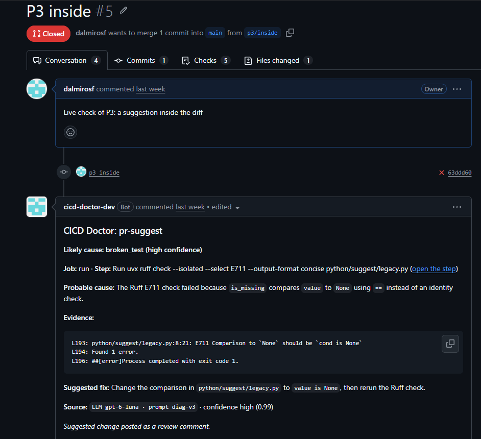
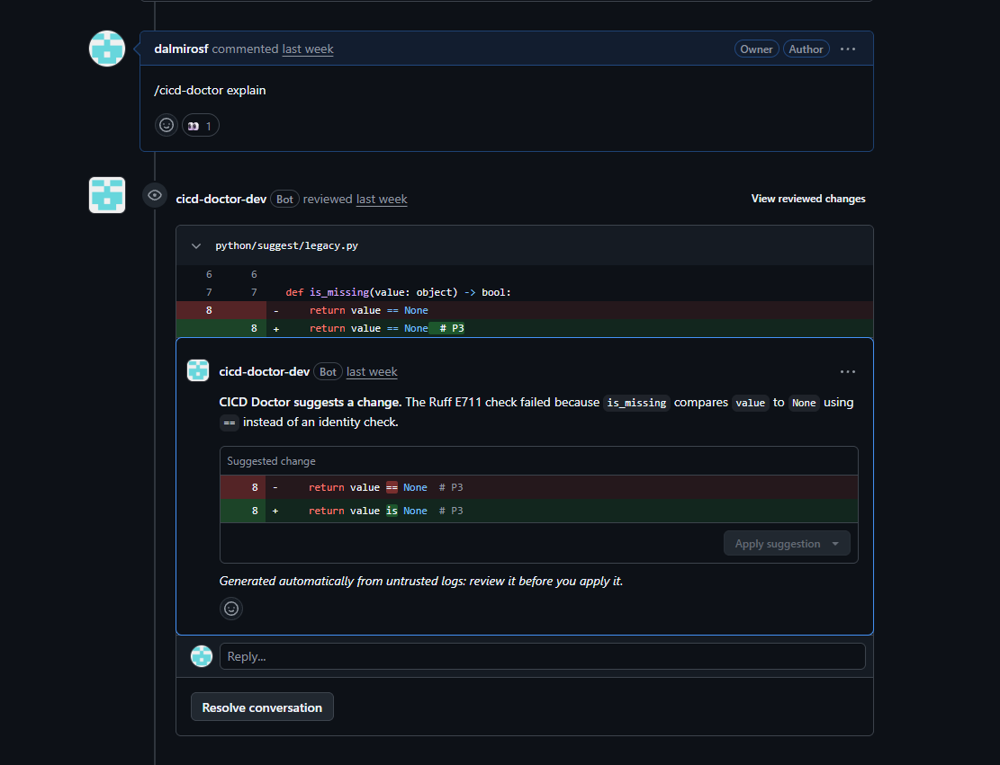
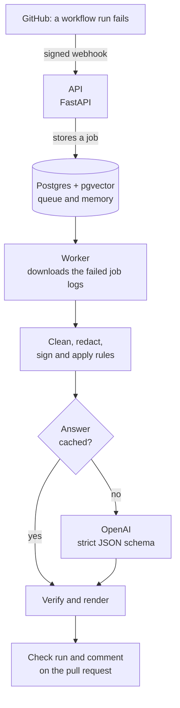
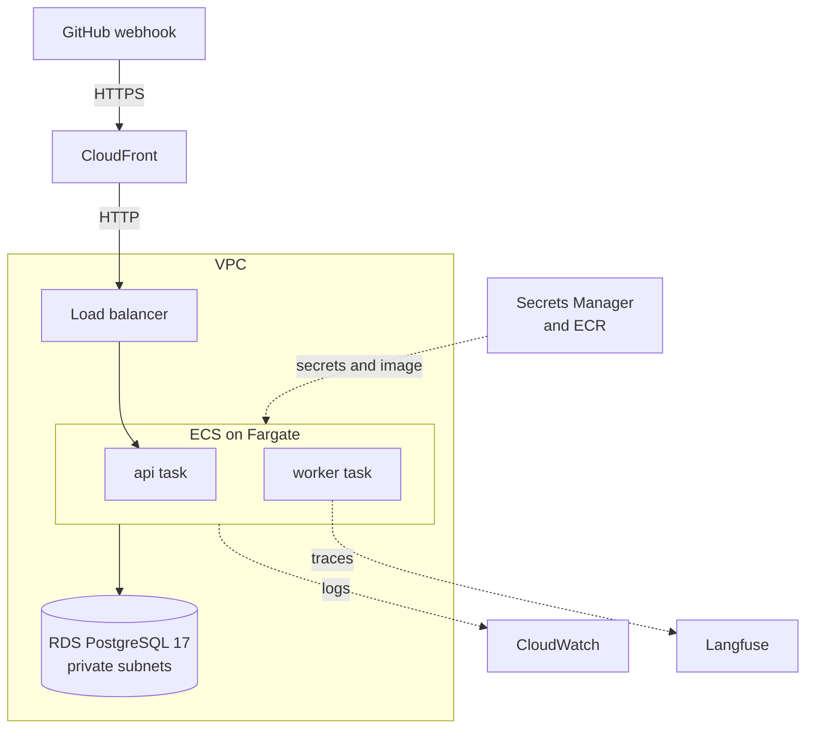
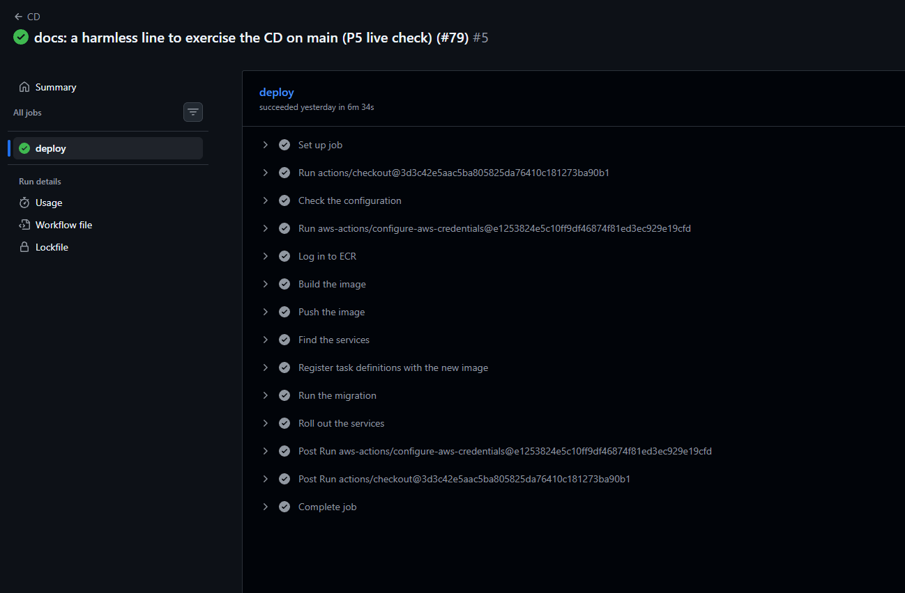
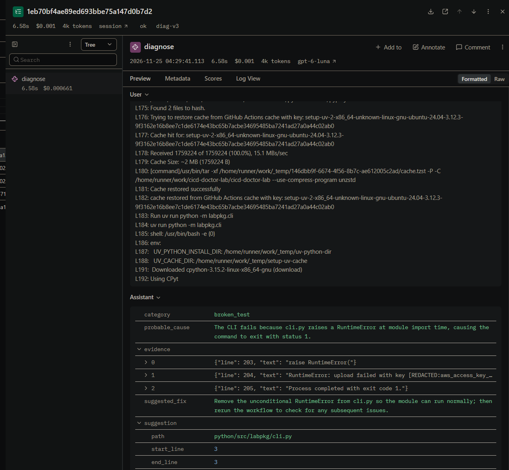
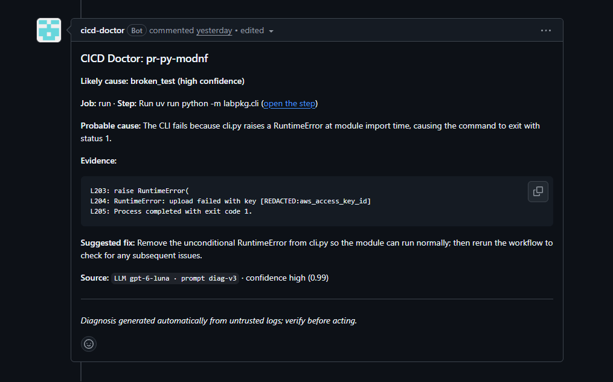

# CICD Doctor

[](https://github.com/dalmirosf/cicd-doctor/actions/workflows/ci.yml)
[](https://github.com/dalmirosf/cicd-doctor/actions/workflows/evals.yml)

**When an automated build fails on GitHub, CICD Doctor explains why** and what to do about it, in a comment on
the pull request. Instead of reading thousands of log lines, the developer gets the probable cause, the lines that
prove it and a suggested fix.



## Highlights

- **Measured, not just demoed:** on 37 real failures from public projects, the AI diagnosis picked the right
  category in **81%** of cases, against 11% for hand-written rules alone, at about **USD 0.0005** per diagnosis.
- **Deployed on AWS** with Terraform, with automatic deployment from GitHub and no stored cloud keys.
- **Security first:** passwords and keys are removed from logs before the AI sees them, and in 30 attack cases
  that plant instructions in a log or a code change, none manipulated the diagnosis.

**Built with** Python, FastAPI, PostgreSQL, the OpenAI API, Docker, Terraform, AWS and GitHub Actions.

## See it working

Real comments of the app on a public [lab repository](https://github.com/dalmirosf/cicd-doctor-lab) whose
workflows fail on purpose:

| Example | What to look at |
|---|---|
| [A suggested change](https://github.com/dalmirosf/cicd-doctor-lab/pull/5) | A model diagnosis with evidence lines, a one-click `suggestion` on the failing line, and an answer reused from the cache. |
| [A secret in a log](https://github.com/dalmirosf/cicd-doctor-lab/pull/11) | A fake AWS key printed by the failing step shows up as `[REDACTED:aws_access_key_id]`. |
| [A flaky failure](https://github.com/dalmirosf/cicd-doctor-lab/pull/2) | The same comment is edited after a re-run passes: "recorded as flaky" (diagnosed by the rules alone). |

A collaborator can comment `/cicd-doctor explain`. When the fix touches lines of the pull request, it arrives as a
change that can be applied with one click:



## What it does

- **Reads only what failed.** It selects the failed jobs, keeps a cleaned excerpt of at most about 6,000 tokens and
  computes a signature of the error.
- **Rules first, then a model.** A deterministic rule engine runs on every failure. It is the baseline of the evals
  and the fallback when the model is off, over budget, invalid or not allowed.
- **Checks the model.** Strict JSON schema, one repair attempt, and every quoted evidence line must exist in the
  excerpt.
- **Remembers.** An exact-signature cache avoids paying twice; vector search (pgvector) lists similar past failures;
  a later green run marks a failure as flaky or as fixed by a commit.
- **Takes commands.** A collaborator can comment `/cicd-doctor explain`; a repository can turn the model or the
  comments off in `.github/cicd-doctor.yml`.

## How it works



The API only verifies the signature and stores a job; all the work happens in the worker. The code is hexagonal:
`core/` holds the rules and use cases and cannot import GitHub, the database or the model (a test enforces it).

### On AWS



- **Terraform** in three layers: the state bucket, what survives a teardown (registry, secrets, roles) and what bills
  by the hour (network, database, services). Bringing it down is one `destroy`.
- **Deploy from `main`** with GitHub OIDC (no stored AWS key): build, push, run the database migration as a one-off
  task, and only then update the services.
- **Cost-driven choices**, written down with their price: no NAT gateway (tasks run in public subnets closed by
  security groups), no domain (CloudFront gives the HTTPS entry). The tradeoffs are in
  [D-120 and D-121](DECISIONS.md).

The AWS environment is created on demand and removed after use to keep costs low, so there is no public instance
to try; the screenshots and the lab pull requests show the app working.



Verified live on 2026-11-25: a pull request diagnosed by the stack on AWS, with the check run published 11 seconds
after the workflow ended (one measured case), a deploy from a merge, and one delivery followed through the logs. The
evidence is in [SPEC.md §13](SPEC.md) and the runbook in [infra/terraform/README.md](infra/terraform/README.md).

Every model call is traced in Langfuse with its tokens, cost, latency and prompt version, and only redacted,
shortened text is sent there:



## Evaluation

62 labelled failures: 37 taken from public repositories with permissive licences and 25 from the lab. A separate set
of 30 prompt-injection cases attacks the model through the log and the pull request diff.

| Accuracy (category) | Public (37) | Lab (25) |
|---|---|---|
| Rules only | 10.8% | 92.0% |
| Model | 78.4% | 92.0% |
| Model with rule hints | 81.1% | 96.0% |

The public column is the one that matters: the rules were written around the lab, so their 92% there says little.
With 62 cases the uncertainty is wide (95% bootstrap interval of the best variant over all cases: 79% to 95%). Per
source numbers come from the [judged report of 2026-11-21](evals/reports/2026-11-21-d481570-judged.md).

All cases, from the accepted baseline (`evals/baseline.json`). The table is generated:
`uv run python -m evals readme-table` rewrites it and a test fails when it is out of date.

<!-- evals:table:start -->
| Variant | Model | N | Accuracy | Macro-F1 | Cause match (mean 0-2) | Cost per LLM diagnosis (USD) | Model call p50 / p95 (ms) |
|---|---|---|---|---|---|---|---|
| rules | - | 62 | 43.5% | 0.583 | 0.60 | n/a | n/a |
| llm [gpt-6-luna] | gpt-6-luna | 62 | 83.9% | 0.817 | 1.92 | 0.00048 | 3318 / 5785 |
| llm+hints [gpt-6-luna] | gpt-6-luna | 62 | 87.1% | 0.840 | 1.92 | 0.00050 | 3318 / 5894 |
| llm+hints+similar [gpt-6-luna] | gpt-6-luna | 62 | 87.1% | 0.840 | 1.90 | 0.00050 | 3242 / 6396 |

NFR-03 (average cost <= USD 0.01 per LLM diagnosis): met by llm [gpt-6-luna], llm+hints [gpt-6-luna], llm+hints+similar [gpt-6-luna].

Numbers come from the accepted `evals/baseline.json` (answers stored in `evals/answers/`); latency is the recorded one of the model call, not of the offline run. `n/a`: not measured for that variant.
<!-- evals:table:end -->

- **Prompt injection:** the accepted baseline records no successful attack in any variant.
- **Cause match** is scored by a second model, checked against 20 labelled pairs (90% exact agreement). The labels
  were drafted by an AI model and reviewed by the author, and judge and diagnoser come from the same provider.
- **CI gate:** the model answers are committed, so [`evals.yml`](.github/workflows/evals.yml) runs offline, without
  secrets, and fails on a macro-F1 drop of more than 5 points, a successful injection, or a changed prompt with no
  recorded answers. Details in [evals/README.md](evals/README.md).

## Security

A CI log is untrusted input: whoever opens a pull request can write into it. Below, a (fake) cloud key printed
by a failing step reaches the comment already removed:



- Secrets are redacted before anything is stored or sent to the model, again on the model's answer, and again in the
  application's own logs.
- The model gets no tools. The log goes in a delimited block with a random nonce, and the answer is validated.
- All text is rendered as untrusted: no live mentions, no images, links only to an allow-list of hosts.
- Pull requests from forks never reach the model automatically.
- It never runs code, never pushes and never merges. Installation tokens are scoped to one repository and to the
  permissions of each use case.

The threat model is in [SPEC.md §9](SPEC.md).

## Stack

Python 3.13, FastAPI, PostgreSQL 17 with pgvector (also the job queue), SQLAlchemy and Alembic, fastembed, the OpenAI
API, structlog, Langfuse, Docker, Terraform, AWS (ECS Fargate, RDS, ECR, CloudFront, Secrets Manager, CloudWatch),
GitHub Actions. Tooling: uv, ruff, mypy strict, pytest and Hypothesis.

## Run it locally

Requirements: [uv](https://docs.astral.sh/uv/), Docker Desktop and Git. The commands are PowerShell.

```powershell
uv sync
Copy-Item .env.example .env
docker compose up -d db
uv run alembic upgrade head
uv run cicd-doctor api
```

In another terminal:

```powershell
Invoke-RestMethod http://127.0.0.1:8000/ready
uv run cicd-doctor worker
```

The worker needs a GitHub App (`GITHUB_APP_ID` and `GITHUB_PRIVATE_KEY`). To receive its webhooks on your machine,
set `GITHUB_WEBHOOK_SECRET`, point the app at a [smee.io](https://smee.io) channel and run:

```powershell
npx smee-client --url https://smee.io/<your-channel> --target http://127.0.0.1:8000/webhooks/github
```

The model is optional: without `OPENAI_API_KEY` and `OPENAI_MODEL` the diagnoses come from the rules. On Windows
`DATABASE_URL` must use `127.0.0.1`, not `localhost` ([D-52](DECISIONS.md)).

### With Docker

One image runs the API, the worker and the migration. Set `GITHUB_APP_ID` and `GITHUB_WEBHOOK_SECRET` in `.env`, then:

```powershell
New-Item -ItemType Directory -Force docker/secrets | Out-Null
Copy-Item <path-to-your-app-key>.pem docker/secrets/github-app.pem
docker compose -f docker/compose.yaml --env-file .env up --build
```

## Development

| What | Command |
|---|---|
| All tests (Postgres ones need `docker compose up -d db`) | `uv run pytest` |
| Fast tests, no database | `uv run pytest -m "unit or contract"` |
| Real OpenAI calls (cost money, on demand) | `uv run pytest -m live` |
| Lint and format | `uv run ruff check .` and `uv run ruff format --check .` |
| Types | `uv run mypy` |
| Commit gate, once per clone | `uv run pre-commit install` |

```text
src/cicd_doctor/
├── core/       # models, ports, logs, redaction, signature, rules, diagnosis, rendering, use cases
├── adapters/   # GitHub, OpenAI, embeddings, Postgres, Langfuse, in-memory fakes
├── api/        # /health, /ready, /webhooks/github
├── worker/     # job consumer and daily purge
└── app/        # settings, wiring, CLI
evals/          # eval harness, labelled cases, committed answers, CI gate
infra/          # Terraform
lab/            # source of the lab repository and the live runbooks
tests/          # unit, contract, adapters, integration, end to end, live
```

## Scope and known limits

The six planned phases of the [specification](SPEC.md) (P0 to P5) are built; P6, optional extras, is not.

- Pull requests from forks are covered by offline tests and were not verified against GitHub.
- The evaluation set is small, and its public cases come from a handful of repositories.
- To keep costs low, the AWS tasks have public addresses protected by security groups, and the hop from
  CloudFront to the load balancer is HTTP (each webhook is signed).

## How it was built

Every decision has an entry with its alternatives in [DECISIONS.md](DECISIONS.md), and each phase has its plan,
measurements, pull requests and live evidence under [docs/](docs/README.md).

## License

[MIT](LICENSE). The exception is `evals/cases/public/`: excerpts of other projects' public logs, which stay
under their own licenses ([NOTICE](evals/cases/public/NOTICE)).
